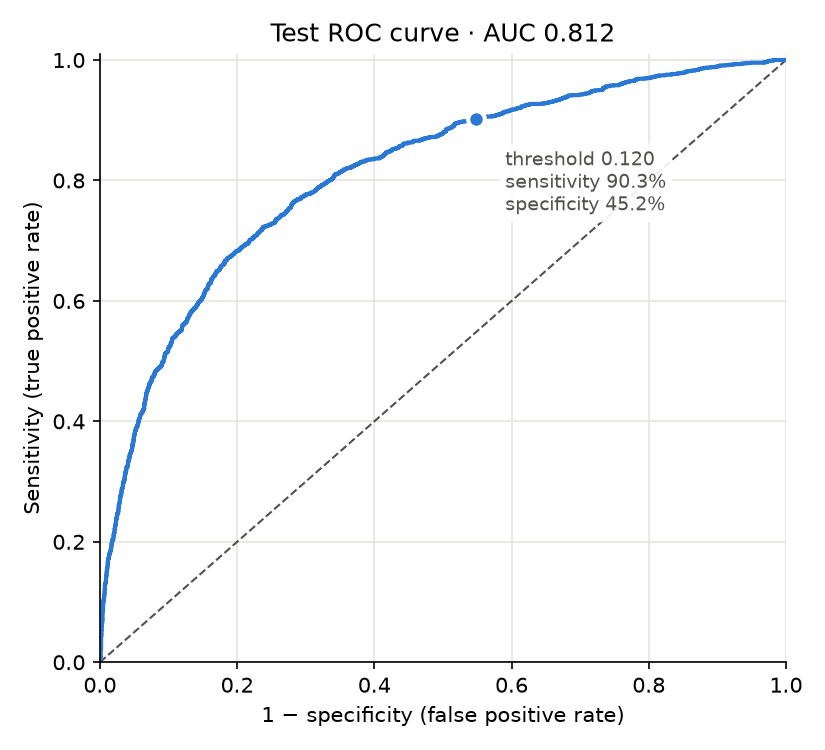
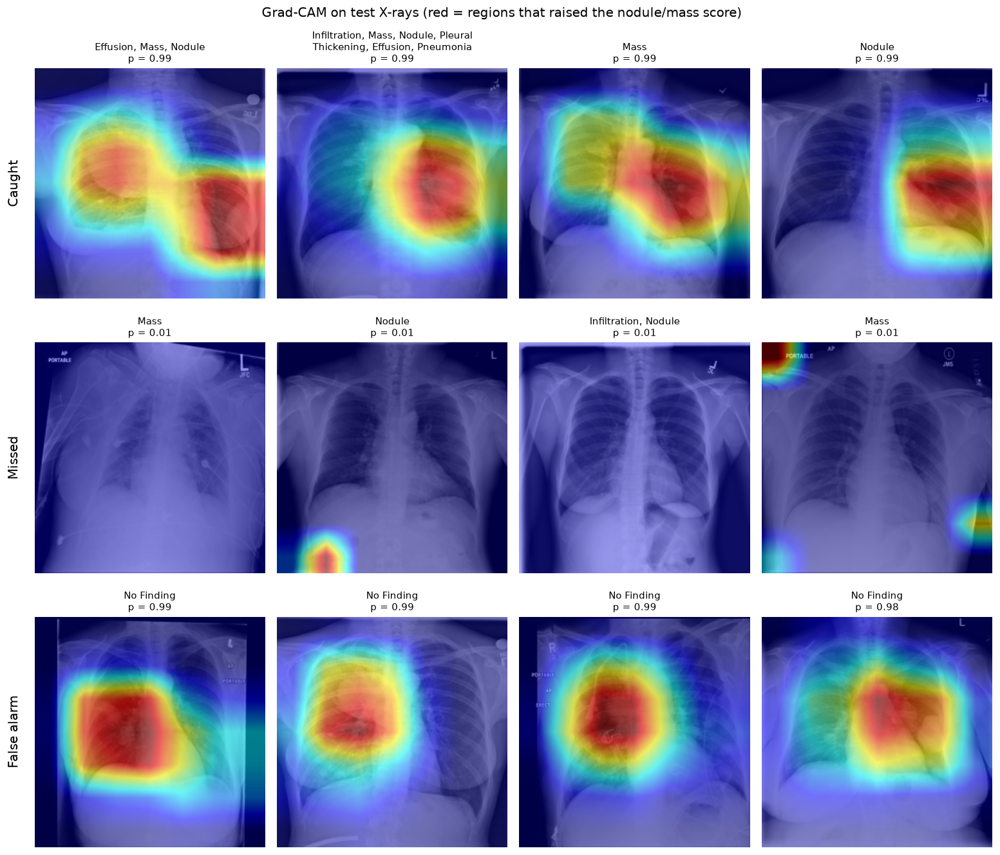

# Chest X-ray Nodule Classifier

Detecting lung nodules and masses on chest X-rays with a fine-tuned DenseNet-121, evaluated on a held-out test set of patients the model never saw.

**Live demo:** [try it on Hugging Face Spaces](https://huggingface.co/spaces/trungvu0307/chest-xray-nodule-demo) · **Trained model:** [Hugging Face](https://huggingface.co/trungvu0307/chest-xray-nodule-densenet121) · **Data:** [NIH ChestX-ray14](https://nihcc.app.box.com/v/ChestXray-NIHCC) · **Stack:** PyTorch, torchvision, scikit-learn, pytorch-grad-cam

> Research and educational project. Not a medical device and not for clinical use.

## Results on the held-out test set

6,966 X-rays from 2,917 patients who were never used for training or model selection. The 95% confidence intervals come from a patient-level bootstrap with 1,000 resamples.

| Metric | Value | 95% CI |
|---|---|---|
| AUC-ROC | **0.812** | 0.794 – 0.827 |
| Sensitivity | **90.3%** | 88.1 – 91.9% |
| Specificity | 45.2% | 43.2 – 47.2% |
| PPV (precision) | 35.9% | 33.2 – 38.5% |

Sensitivity, specificity and PPV are measured at a decision threshold of 0.120, which was chosen on the validation set to reach 90% sensitivity. PPV reflects this cohort's 25% positive rate and would be lower where nodules are rarer.



### Where the model struggles

- **Nodules vs masses:** masses (larger than 3 cm) are caught more often than nodules: 92.6% vs 86.8% sensitivity.
- **Alone vs with other findings:** sensitivity is 86.8% when the nodule or mass is the only finding, and 93.5% when other findings such as effusion or infiltration are also present. The negatives are all "No Finding" X-rays, so part of what the model learned is "abnormal vs normal".
- **X-ray view:** AUC is 0.773 on AP (bedside, often portable) X-rays vs 0.829 on PA X-rays.

### Grad-CAM



Heatmaps for the most confident correct detections (top), the worst misses (middle) and the most confident false alarms (bottom). Both detections and false alarms focus on the lung fields rather than on text markers or image borders. The missed cases get almost no activation.

## Approach

- **Data:** NIH ChestX-ray14 has 112,120 frontal X-rays from 30,805 patients.
  - Positives: every X-ray labelled *Nodule* or *Mass* (11,207).
  - Negatives: *No Finding* X-rays, sampled at 3 per positive.
  - X-rays with only other findings are excluded.
  - The final cohort has 44,828 images.
- **Patient-level split:** the cohort is split into train, validation and test sets of 31,055, 6,807 and 6,966 images. No patient appears in more than one split, so the model can't score well by recognising patients.
- **Model:** an ImageNet-pretrained DenseNet-121 (the CheXNet backbone) with a single-logit head and 224×224 input.
- **Training:**
  - Loss: BCE with `pos_weight` ≈ 3 to offset the class imbalance.
  - Optimiser: AdamW (lr 3e-5, weight decay 1e-2) with a cosine learning-rate schedule.
  - Augmentation: random crops, rotations up to 10°, small shifts, and brightness and contrast changes. Horizontal flips aren't used, because a flipped X-ray puts the heart on the wrong side.
  - Early stopping on validation AUC.
  - Hardware: an Apple M5 GPU (PyTorch MPS), about 16 minutes per epoch.
- **Evaluation:** the threshold is chosen on validation. The test set is used once, at the end.

### Experiment log

| Run | What changed | Best val AUC |
|---|---|---|
| 1 | Baseline on 3 of the 12 image archives (7,828 images) | 0.766 |
| 2 | All 12 archives (44,828 images) | 0.826 |
| 3 | Run 2 + lower learning rate, more weight decay, stronger augmentation | 0.826 (final model) |

- **More data was the biggest lever:** +0.06 AUC.
- **Extra regularisation** delayed overfitting by about 2 epochs but didn't raise validation AUC.
- **Validation was slightly optimistic:** the final model scored 0.826 on validation but 0.812 on test, because the best epoch was picked on validation.

## Repository structure

```
notebooks/
  00_colab_prepare_data.ipynb (Colab only) download, filter and shrink the images into Google Drive
  01_data_exploration.ipynb   download, label analysis, cohort, patient-level split
  02_train.ipynb              fine-tuning, early stopping, threshold selection, run comparison
  03_evaluate.ipynb           test metrics with CIs, subgroup analysis, Grad-CAM
data/splits/                  the fixed train / validation / test split (CSV)
reports/                      figures and test metrics used in this README
space/                        Gradio demo deployed to Hugging Face Spaces
requirements.txt
```

## Reproduce

```bash
python -m venv .venv && source .venv/bin/activate
pip install -r requirements.txt
```

Run the notebooks in order. Notebook 1 downloads about 42 GB of images. The notebooks use a CUDA GPU or the Mac GPU (MPS) when one is available, and otherwise the CPU.

### On Google Colab (free GPU, nothing downloaded to your computer)

1. [](https://colab.research.google.com/github/vutr2/chest_xray_classifier/blob/main/notebooks/00_colab_prepare_data.ipynb) **Once:** `00_colab_prepare_data` does the data preparation on Colab:
   - downloads the archives
   - keeps the 44,828 X-rays listed in `data/splits/`
   - shrinks them to 512×512
   - saves a single `images_512.tar` (about 5 GB) to `MyDrive/chest_xray_classifier/` in Google Drive
2. [](https://colab.research.google.com/github/vutr2/chest_xray_classifier/blob/main/notebooks/02_train.ipynb) `02_train`: first choose **Runtime → Change runtime type → T4 GPU**. The first cell connects Google Drive and unpacks the images, and checkpoints are saved to Drive.
3. [](https://colab.research.google.com/github/vutr2/chest_xray_classifier/blob/main/notebooks/03_evaluate.ipynb) `03_evaluate`: reads the checkpoint from Drive and writes its reports there.

To use the trained model without training, run `pip install huggingface_hub` and then:

```python
import torch
import torch.nn as nn
from huggingface_hub import hf_hub_download
from torchvision import models

ckpt = torch.load(hf_hub_download("trungvu0307/chest-xray-nodule-densenet121", "model.pt"), map_location="cpu")
model = models.densenet121(weights=None)
model.classifier = nn.Linear(model.classifier.in_features, 1)
model.load_state_dict(ckpt["state_dict"])
model.eval()
# Input: the X-ray as a 3-channel RGB image, resized to 224×224, with ImageNet mean/std normalisation.
# Output: sigmoid(logit) = probability of nodule/mass. ckpt["threshold"] is the decision threshold (0.120).
```

## Limitations

- **Noisy labels:** the ChestX-ray14 labels were text-mined from radiology reports, so some are wrong.
- **Normal X-rays only as negatives:** the model was never shown X-rays with other diseases and no nodule, so in real use it would likely flag many of them.
- **Low resolution:** at 224×224 input, small nodules can lose detail.
- **One source:** all the data comes from one hospital, and there is no external validation.
- **Many false alarms:** at 90% sensitivity, specificity is 45%, far too many false alarms for practical use.

## Data and citation

Data provided by the NIH Clinical Center ([download](https://nihcc.app.box.com/v/ChestXray-NIHCC)). The images aren't included in this repository.

> Wang X, Peng Y, Lu L, Lu Z, Bagheri M, Summers RM. *ChestX-ray8: Hospital-scale Chest X-ray Database and Benchmarks on Weakly-Supervised Classification and Localization of Common Thorax Diseases.* CVPR 2017.
